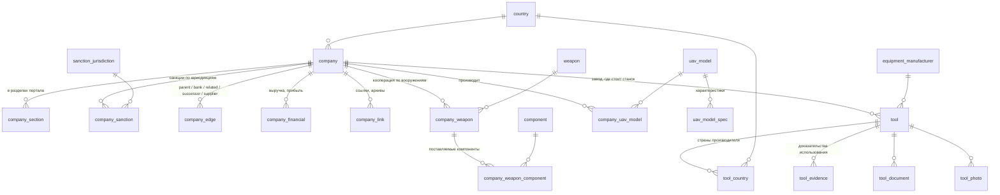

# База данных предприятий

Документация по схеме PostgreSQL. DDL — миграции в [`../migrations/`](../migrations/). Загрузчик ГУР: `src/company_parse/db/gur_loader.py`. Инструкции для загрузки вакансий другими командами: [loading/](loading/).

| Документ | Что внутри |
|---|---|
| [tables.md](tables.md) | все таблицы и колонки: тип, смысл, откуда берётся, заполненность |
| [data_notes.md](data_notes.md) | особенности и ограничения данных, которые важны при запросах |
| [queries.md](queries.md) | примеры запросов |
| [changelog.md](changelog.md) | история изменений схемы |
| [loading/](loading/) | как загружать вакансии: [общие правила](loading/README.md), [HH](loading/hh.md), [trudvsem](loading/trudvsem.md) |
| [proposals/](proposals/) | обоснования расширений схемы: [вакансии HH + trudvsem](proposals/vacancies.md) (применено миграцией 0002) |

Состояние на 05.10.2026: применены миграции `0001_initial`, `0002_vacancies` и `0003_supply_and_financials`. Загружен портал ГУР «War & Sanctions» (разделы Ростех, БпЛА, заводы, станки, санкционные юрлица) и связи поставок и финансы из атласа ВПК коллеги; таблицы вакансий созданы и ждут загрузки от команд HH и trudvsem. Боевая БД — PostgreSQL 18 на Railway.

## Модель



Группы таблиц:

| Группа | Таблицы | Строк |
|---|---|---|
| Компании | `company`, `company_section`, `company_link` | 7530 / 8173 / 8216 |
| Санкции | `company_sanction`, `sanction_jurisdiction` | 61 559 / 9 |
| Граф компаний | `company_edge` | 1809 |
| Финансы (0003) | `company_financial` | 8 |
| Вооружения | `weapon`, `component`, `company_weapon`, `company_weapon_component` | 32 / 307 / 825 / 615 |
| БпЛА | `uav_model`, `uav_model_spec`, `company_uav_model` | 209 / 1233 / 402 |
| Оборудование | `tool`, `equipment_manufacturer`, `tool_country`, `tool_evidence`, `tool_document`, `tool_photo` | 1567 / 460 / 1731 / 1602 / 3263 / 156 |
| Справочники, происхождение | `country`, `source_record` | 117 / 9949 |
| Вакансии (0002) | `vacancy_source`, `region`, `employer_profile`, `employer_company_match`, `vacancy`, `vacancy_hh`, `vacancy_trudvsem`, `vacancy_discovery`, `vacancy_snapshot`, `vacancy_company_match` | пусто (кроме `vacancy_source` = 2) |
| Классификация ВПК (0002) | `classifier_run`, `vacancy_classification`, `employer_classification`, `classification_evidence`, `manual_review` | пусто |
| OpenSanctions (0002) | `opensanctions_entity`, `opensanctions_code` | пусто |
| Служебная | `schema_migration` | журнал миграций |

## Принципы

- **`company_id` — суррогатный ключ.** `company.gur_id` уникален, но компании из будущих источников (hh.ru, ЕГРЮЛ) его не будут иметь.
- **`gur_id` — единое пространство id портала.** Один номер у компании во всех разделах; банки, правопреемники, связанные компании, заводы станков и производители БпЛА — тоже компании этого пространства.
- **ИНН и ОГРН не уникальны.** Филиалы делят номера головной компании (19 ИНН на 64 компании). Для сопоставления с внешними источниками ключ — ИНН (+ОГРН, +страна), но склеивать компании ГУР по нему нельзя.
- **Переводы — колонками** `*_uk`, `*_ru`, `*_en`: портал трёхъязычный. Русские варианты нужны для сопоставления с российскими источниками.
- **Все связи компания–компания — в одной таблице `company_edge`**, различаются `kind` и `source`.
- **Отсутствие явно:** в `company_sanction` есть строки и для юрисдикций без санкций (`is_sanctioned = false`).
- **Происхождение:** каждая сущность имеет строку в `source_record` с URL и путём к сохранённому HTML (`data/raw/...`), откуда её можно переразобрать.

## Загрузка и обновление

```bash
uv run company-db status      # версия сервера, применённые/ожидающие миграции, строки по таблицам
uv run company-db migrate     # применить недостающие db/migrations/NNNN_*.sql
uv run company-db load-gur    # загрузить data/gur-*.jsonl
uv run company-db load-vpk-atlas  # связи поставок и финансы из other_vacancies/vpk-structured.json
```

Подключение берётся из `--dsn`, `$DATABASE_URL` или `.env` (JDBC-URL плюс `USER`/`PASSWORD`). `load-vpk-atlas` (`src/company_parse/db/vpk_atlas_loader.py`) запускается после `load-gur`: он находит компании атласа в `company` и пишет только строки с `source = 'vpk_atlas'`. Обе загрузки идемпотентны и не трогают строки друг друга. Загрузка ГУР идёт одной транзакцией: компании обновляются по `gur_id`, дочерние строки загружаемых сущностей удаляются и вставляются заново. Компании, на которые есть ссылки, но которых нет в данных, создаются заглушками (сейчас одна — `gur_id` 15111).

## Миграции

`db/migrations/NNNN_name.sql` применяются по порядку, каждая в своей транзакции вместе с записью в `schema_migration`. Применённую миграцию не правят — изменение оформляется новой. `migrate --drop-all` удаляет все таблицы схемы `public` перед применением — только для локальных/тестовых БД.

Учётная запись из `.env` — суперпользователь. Для разработчиков вакансий подготовлена роль с правами только на таблицы вакансий: [`../roles/vacancy_loader.sql`](../roles/vacancy_loader.sql) (не применена).

## Как вести эту документацию

При изменении схемы в одном изменении правятся: новая миграция в `../migrations/`, загрузчик, [tables.md](tables.md) и запись в [changelog.md](changelog.md). Если меняется смысл данных или найдена новая особенность источника — [data_notes.md](data_notes.md). Цифры заполненности обновляются после загрузки запросом из [queries.md](queries.md#заполненность-колонок).
