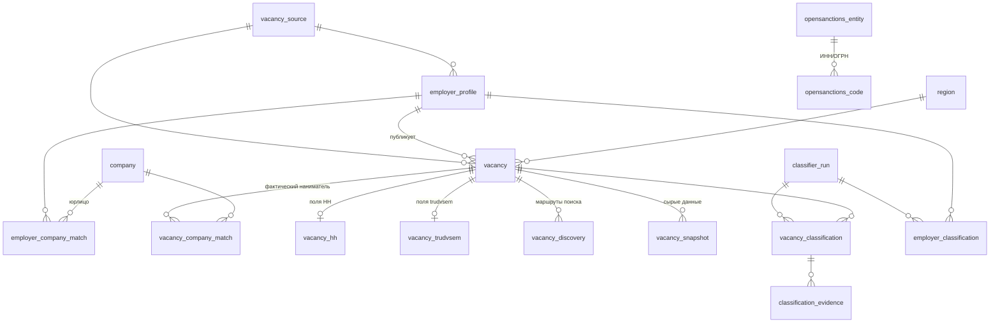

# Предложение: общая схема вакансий (HH + trudvsem)

*05.10.2026. Развилки раздела 4 решены (приняты рекомендованные варианты). Применено миграцией [`0002_vacancies`](../../migrations/0002_vacancies.sql) — она и есть итоговое DDL; инструкции для загрузки — [../loading/](../loading/).*

Источники: отчёт по HH (`README (1).md`, схема `vacancies_app` для PostgreSQL) и отчёт по trudvsem (`DATA_REPORT.md`, проект SQLite). Авторы не знали друг о друге и о нашей схеме предприятий (`company` и др., см. [../README.md](../README.md)).

## 1. Что есть у каждого

| | HH | trudvsem |
|---|---|---|
| Способ сбора | HTML-страницы, очередь в SQLite | открытый API, JSON |
| Вакансий | 20 075 полных карточек | 480 305 |
| Работодателей | 4 718 профилей HH (у 40 карточек профиля нет) | 82 140 уникальных ИНН (без ИНН — 31 вакансия) |
| ИНН/ОГРН работодателя | нет | есть, плюс **КПП** и `companycode` |
| Регион | в основном город/населённый пункт | субъект РФ + код КЛАДР (92 региона), адрес с координатами |
| Тексты | `description`, `responsibilities`, `requirements`, `conditions` | `duty`, `requirements`, `term.text` (11%) |
| Навыки | готовая строка, **нельзя делить по запятым** | JSON-массив (16%) |
| Зарплата | from/to/currency + `salary_gross`, `salary_period` | min/max/currency |
| Только у этого источника | имя работодателя в карточке и в деталях, статус разрешения работодателя, тип адреса, видимость, маршруты поиска | профессия и её код по справочнику, отрасль, число рабочих мест, класс условий труда, тип рабочего места, квалификация, дата найма, медкнижка, льготы, сменность, соцзащищённые, тип источника (работодатель / агентство / импорт с сайта) |
| Классификация ВПК | поля фильтра в карточке: `filter_decision`, `filter_matches`, `vpk_status`, `vpk_evidence` | прогоны классификатора, уровни «точно / вероятно / нет / вне охвата», оценка, категория, построчные признаки, ручная проверка |
| Санкции | — | OpenSanctions: 9 991 российская организация, программы (UA-SA1644, US-RUSHAR, ...) |
| Сырые данные | пути к HTML.gz + SHA-256 + HTTP-статус | предлагали хранить gzip-JSON прямо в БД |
| Контакты | поля есть, пусты | осознанно не хранятся (персональные данные) |
| Связь с юрлицами | своя таблица `companies` + сопоставления со статусами `candidate` / `verified` / `predicted` | работодатель = юрлицо, ключ ИНН (UNIQUE) |

## 2. Конфликты, которые нужно разрешить

1. **Три таблицы юрлиц.** У HH `companies`, у trudvsem `employer`, у нас `company`. Предлагаю одну — нашу `company`. Оба автора закладывали ровно её: «юрлицо с ИНН/ОГРН из ГУР и других источников».
2. **ИНН не уникален.** trudvsem делает `employer.inn UNIQUE`, но в данных ГУР 19 ИНН делят 64 компании (головная и филиалы). Филиал различается по **КПП**, а trudvsem его отдаёт. Ключ юрлица — суррогатный, ИНН и КПП — атрибуты.
3. **Работодатель на сайте ≠ юрлицо.** Профиль HH не имеет ИНН, агентство публикует вакансии за завод (у trudvsem 1 751 вакансия кадровых агентств и 69 565 импортированных с других сайтов). Нужен слой «профиль работодателя на сайте» и отдельное сопоставление со статусом. Это предложил HH, и это совпадает с `employer_external_id` у trudvsem.
4. **Регион значит разное.** У trudvsem это субъект РФ, у HH — город. Общая колонка `region` склеит несравнимое: нужны отдельно `region_id` (субъект) и `locality` (город).
5. **Разные словари классификации.** `candidate_seed_employer` / `candidate_strong_signal` у HH против «точно» / «вероятно» у trudvsem. Общая модель прогонов (от trudvsem) с нормализованным уровнем плюс исходная метка.
6. **Сырые данные.** Блобы в БД (у trudvsem 1,6 ГБ JSON) против путей к файлам (у HH и у нас для ГУР — `source_record.raw_html_path`).
7. **Операционные таблицы** `crawl_run` / `crawl_task` у trudvsem и очередь у HH — это состояние парсеров, а не данные; в общую БД их не переносим.

## 3. Предлагаемая схема

Схема отражает принятые решения из раздела 4.



### Источники и справочники

```sql
CREATE TABLE vacancy_source (
    code      text PRIMARY KEY,               -- 'hh', 'trudvsem'
    name      text NOT NULL,
    base_url  text
);

-- Субъект РФ. У trudvsem приходит с кодом КЛАДР; у HH выводится из города позже.
CREATE TABLE region (
    region_id   serial PRIMARY KEY,
    name        text NOT NULL UNIQUE,         -- 'Тульская область'
    kladr_code  text UNIQUE                   -- 13 цифр
);
```

### Работодатели на сайтах и их юрлица

```sql
-- Профиль публикатора на конкретном сайте (HH employer_id, trudvsem companycode).
-- Реквизиты — как их показывает сайт; это утверждение сайта, а не проверенный факт.
CREATE TABLE employer_profile (
    employer_profile_id  bigserial PRIMARY KEY,
    source               text NOT NULL REFERENCES vacancy_source,
    id_namespace         text NOT NULL DEFAULT '',   -- HH employer_id_namespace
    external_id          text NOT NULL,
    name                 text NOT NULL,
    url                  text,
    inn                  text,                        -- trudvsem: company.inn
    ogrn                 text,
    kpp                  text,                        -- отличает филиал
    publisher_type       text NOT NULL DEFAULT 'unknown'
                         CHECK (publisher_type IN ('employer', 'agency', 'unknown')),
    first_seen_at        timestamptz NOT NULL,
    last_seen_at         timestamptz NOT NULL,
    UNIQUE (source, id_namespace, external_id)
);
CREATE INDEX employer_profile_inn_idx ON employer_profile (inn, kpp);

-- Профиль ↔ юрлицо (company). Автоматическое совпадение ИНН — 'auto', не 'verified'.
CREATE TABLE employer_company_match (
    employer_profile_id  bigint NOT NULL REFERENCES employer_profile ON DELETE CASCADE,
    company_id           bigint NOT NULL REFERENCES company ON DELETE CASCADE,
    status               text NOT NULL
                         CHECK (status IN ('auto', 'candidate', 'predicted', 'verified', 'rejected')),
    method               text NOT NULL,         -- 'inn_kpp', 'inn', 'name_region', 'nlp', 'manual'
    confidence           real,                  -- не калиброванная вероятность
    model_version        text,
    evidence             jsonb,
    reviewed_by          text,
    reviewed_at          timestamptz,
    created_at           timestamptz NOT NULL DEFAULT now(),
    PRIMARY KEY (employer_profile_id, company_id),
    CHECK (status <> 'verified'
           OR (reviewed_by IS NOT NULL AND reviewed_at IS NOT NULL AND evidence IS NOT NULL))
);
```

В `company` добавляется `kpp text` (миграция) — у ГУР его нет, у trudvsem есть.

### Вакансии: общее ядро + поля конкретного источника

```sql
CREATE TABLE vacancy (
    vacancy_id           bigserial PRIMARY KEY,
    source               text NOT NULL REFERENCES vacancy_source,
    external_id          text NOT NULL,          -- HH id / trudvsem UUID
    url                  text NOT NULL,
    employer_profile_id  bigint REFERENCES employer_profile,  -- NULL: профиль неизвестен
    employer_name        text,                   -- имя публикатора как в карточке

    title                text NOT NULL,
    profession           text,                   -- trudvsem typicalPosition
    profession_code      text,
    specialisation       text,                   -- отрасль по классификатору сайта

    region_id            int REFERENCES region,  -- субъект РФ
    locality             text,                   -- город/населённый пункт
    address              text,
    lat                  numeric(9,6),
    lng                  numeric(9,6),

    salary_from          numeric(18,2),
    salary_to            numeric(18,2),
    salary_currency      text,
    salary_gross         boolean,                -- NULL = неизвестно
    salary_period        text,                   -- 'unspecified_by_source' ≠ месяц

    employment           text,
    schedule             text,
    experience           text,                   -- как на сайте
    experience_years     smallint,
    education            text,

    description          text,                   -- полный текст (HH)
    responsibilities     text,                   -- HH responsibilities / trudvsem duty
    requirements         text,
    conditions           text,                   -- HH conditions / trudvsem term.text
    skills_raw           text,                   -- как опубликовано; не делить по запятым

    published_at         timestamptz,            -- HH published / trudvsem creation-date
    modified_at          timestamptz,            -- trudvsem date_modify
    first_seen_at        timestamptz NOT NULL,
    last_seen_at         timestamptz NOT NULL,
    is_active            boolean NOT NULL DEFAULT true,

    UNIQUE (source, external_id)
);
CREATE INDEX vacancy_employer_idx ON vacancy (employer_profile_id);
CREATE INDEX vacancy_region_idx   ON vacancy (region_id);
CREATE INDEX vacancy_modified_idx ON vacancy (modified_at);

CREATE TABLE vacancy_hh (
    vacancy_id                  bigint PRIMARY KEY REFERENCES vacancy ON DELETE CASCADE,
    employer_name_detail        text,
    employer_resolution_status  text,
    address_type                text,
    detail_status               text,
    source_visibility           text
);

CREATE TABLE vacancy_trudvsem (
    vacancy_id          bigint PRIMARY KEY REFERENCES vacancy ON DELETE CASCADE,
    origin              text,     -- тип источника: работодатель / интернет-ресурс / агентство / ...
    work_places         int,
    work_conditions     text,     -- класс условий: «Вредные» и т.п.
    work_place_type     text,     -- обычное / квотируемое / спец. / для иностранцев
    qualification       text,
    hire_date           date,
    medical_documents   text,
    social_protected    text,
    benefits            text,
    shift               text,
    skills              text[]    -- исходный массив
);

-- HH: все маршруты поиска, через которые найдена вакансия. Даты не выдумываем.
CREATE TABLE vacancy_discovery (
    vacancy_id     bigint NOT NULL REFERENCES vacancy ON DELETE CASCADE,
    route          text NOT NULL,
    first_seen_at  timestamptz,
    last_seen_at   timestamptz,
    PRIMARY KEY (vacancy_id, route)
);

-- Сырые данные лежат файлами; в БД — где лежат и как проверить.
CREATE TABLE vacancy_snapshot (
    vacancy_id   bigint NOT NULL REFERENCES vacancy ON DELETE CASCADE,
    fetched_at   timestamptz NOT NULL,
    format       text NOT NULL CHECK (format IN ('html', 'json')),
    path         text NOT NULL,       -- HH: HTML.gz; trudvsem: файл JSONL
    locator      text,                -- trudvsem: номер строки / смещение в JSONL
    http_status  smallint,
    sha256       text,
    PRIMARY KEY (vacancy_id, fetched_at)
);

-- Вакансия ↔ фактический наниматель (агентство публикует за завод; NLP; ручная проверка).
CREATE TABLE vacancy_company_match (
    vacancy_id     bigint NOT NULL REFERENCES vacancy ON DELETE CASCADE,
    company_id     bigint NOT NULL REFERENCES company ON DELETE CASCADE,
    status         text NOT NULL CHECK (status IN ('candidate', 'predicted', 'verified', 'rejected')),
    method         text NOT NULL,
    confidence     real,
    model_version  text,
    evidence       jsonb,
    reviewed_by    text,
    reviewed_at    timestamptz,
    PRIMARY KEY (vacancy_id, company_id, method)
);
```

### Классификация ВПК

Модель прогонов trudvsem; фильтр HH загружается как отдельный прогон со своими исходными метками.

```sql
CREATE TABLE classifier_run (
    run_id        serial PRIMARY KEY,
    classifier    text NOT NULL,          -- 'trudvsem_vpk_rules', 'hh_filter', 'nlp_...'
    version       text,
    rules_sha256  text,
    params        jsonb,                  -- версия санкций, пороги, ...
    started_at    timestamptz NOT NULL,
    note          text
);

CREATE TABLE vacancy_classification (
    run_id      int    NOT NULL REFERENCES classifier_run,
    vacancy_id  bigint NOT NULL REFERENCES vacancy ON DELETE CASCADE,
    level       text   NOT NULL CHECK (level IN ('confirmed', 'likely', 'review', 'no', 'out_of_scope')),
    raw_label   text   NOT NULL,          -- 'точно', 'candidate_strong_signal', ...
    score       real,
    category    text,                     -- производство / НИИ-КБ / ремонт / военная служба
    PRIMARY KEY (run_id, vacancy_id)
);

CREATE TABLE employer_classification (
    run_id               int    NOT NULL REFERENCES classifier_run,
    employer_profile_id  bigint NOT NULL REFERENCES employer_profile ON DELETE CASCADE,
    level                text   NOT NULL,
    raw_label            text   NOT NULL,
    score                real,
    category             text,
    PRIMARY KEY (run_id, employer_profile_id)
);

CREATE TABLE classification_evidence (
    run_id      int    NOT NULL,
    vacancy_id  bigint NOT NULL,
    signal      text   NOT NULL,          -- 'санкции', 'гособоронзаказ / военная приёмка', ...
    origin      text   NOT NULL,          -- own_text / employer_text / company_name / sanctions
    weight      real,
    snippet     text,
    FOREIGN KEY (run_id, vacancy_id) REFERENCES vacancy_classification ON DELETE CASCADE
);

CREATE TABLE manual_review (
    review_id            bigserial PRIMARY KEY,
    vacancy_id           bigint REFERENCES vacancy,
    employer_profile_id  bigint REFERENCES employer_profile,
    verdict              text NOT NULL CHECK (verdict IN ('vpk', 'not_vpk', 'unclear')),
    comment              text,
    reviewed_by          text NOT NULL,
    reviewed_at          timestamptz NOT NULL,
    CHECK ((vacancy_id IS NULL) <> (employer_profile_id IS NULL))
);
```

### Санкции OpenSanctions

Отдельно от `company_sanction` (ГУР): другая гранулярность (программы, а не юрисдикции) и другая сущность (запись OpenSanctions, а не профиль ГУР). Связь с `company` и `employer_profile` — по ИНН/ОГРН запросом, без внешнего ключа.

```sql
CREATE TABLE opensanctions_entity (
    os_id            text PRIMARY KEY,
    name             text NOT NULL,
    programs         text[] NOT NULL,       -- 'UA-SA1644', 'US-RUSHAR', ...
    defense_hint     text,
    dataset_version  text NOT NULL
);

CREATE TABLE opensanctions_code (
    kind   text NOT NULL CHECK (kind IN ('inn', 'ogrn')),
    code   text NOT NULL,
    os_id  text NOT NULL REFERENCES opensanctions_entity ON DELETE CASCADE,
    PRIMARY KEY (kind, code, os_id)
);
```

## 4. Развилки и принятые решения

| # | Вопрос | Варианты | Решение (05.10.2026) |
|---|---|---|---|
| 1 | Куда класть 82 тыс. работодателей trudvsem с ИНН | **A.** Только в `employer_profile` (ИНН — атрибут профиля); в `company` — лишь сопоставленные с ГУР или признанные ВПК. **B.** Все в `company`: таблица становится реестром всех юрлиц. | **A.** `company` остаётся базой предприятий интереса (7,5 тыс.), а не реестром больниц и школ; запросы «вакансии предприятия» идут через `employer_company_match` |
| 2 | Поля, которые есть только у одного источника | **A.** Ядро `vacancy` + таблицы `vacancy_hh`, `vacancy_trudvsem` (1:1, типизированы). **B.** Ядро + колонка `jsonb` с остатком. **C.** Одна широкая таблица. | **A.** Новый сайт — новая таблица `vacancy_<source>` |
| 3 | Словари классификации | **A.** Общие прогоны, нормализованный `level` + исходная `raw_label`; фильтр HH — прогон `hh_filter`. **B.** Оставить поля фильтра HH в карточке, прогоны — только trudvsem. | **A.** Поля фильтра HH (`filter_decision`, `filter_matches`, `vpk_status`, `vpk_evidence`) в карточку не идут — они становятся прогоном `hh_filter` |
| 4 | Сырые данные | **A.** Файлы + путь/хэш в `vacancy_snapshot`. **B.** gzip-блоб в БД (+0,5 ГБ). | **A.** Файлы + путь/хэш в `vacancy_snapshot` |

Решено без вопросов (оба автора и наш подход согласны):

- Ключ вакансии — `(source, external_id)`; повторный сбор обновляет строку. Одна работа на двух сайтах автоматически не сливается; дубли между сайтами (69 565 импортированных вакансий trudvsem) — отдельной таблицей позже.
- Личные контакты (ФИО, телефоны, e-mail) не храним.
- Автоматическое совпадение ИНН — не «подтверждено»; `verified` требует проверяющего, время и доказательства.
- `crawl_run` / `crawl_task` и очереди остаются в парсерах.
- `first_seen_at` / `last_seen_at` / `is_active` (от trudvsem) — для динамики найма при регулярных выгрузках. История версий карточек (HH предупреждал) — позже, если понадобится.

## 5. Объём

~500 тыс. вакансий с текстами — порядка 1–1,5 ГБ в PostgreSQL без сырых данных (оценка; проверить на загрузке). Нужно убедиться, что лимит хранилища Railway это позволяет.

## 6. Что нужно для загрузки

| Источник | Файлы | Что из них берётся |
|---|---|---|
| HH | `data/hh_fast/full_cards.jsonl` | 20 075 карточек → `vacancy`, `vacancy_hh`, `employer_profile`; поля фильтра → прогон `hh_filter` |
| HH | `data/hh_fast/queue.sqlite3` (checkpoint) | все маршруты поиска → `vacancy_discovery`; метаданные HTML → `vacancy_snapshot` |
| HH | `data/hh_fast/...`, `data/hh_bulk/raw` | сами HTML.gz (на них указывают пути) |
| trudvsem | `parsers/data/vacancies.jsonl` (1,6 ГБ) | 480 305 вакансий → `vacancy`, `vacancy_trudvsem`, `employer_profile`, `region`; номер строки → `vacancy_snapshot.locator` |
| trudvsem | результат классификатора | уровни, оценки, категории **и построчные признаки** → `classifier_run`, `vacancy_classification`, `employer_classification`, `classification_evidence`. В `vpk_vacancies.csv` признаки склеены в одну строку `vpk_evidence` — лучше выгрузка из самого классификатора (или его запуск с записью в БД) |
| trudvsem | `parsers/data/sources/sanctions.ftm.json` или его индекс | российские организации OpenSanctions → `opensanctions_*` |

Порядок загрузки: справочники (`vacancy_source`, `region`) → `employer_profile` → `vacancy` + таблицы источника → снимки и маршруты → прогоны классификации → OpenSanctions → автоматические сопоставления с `company` по ИНН (+КПП) со статусом `auto`.
